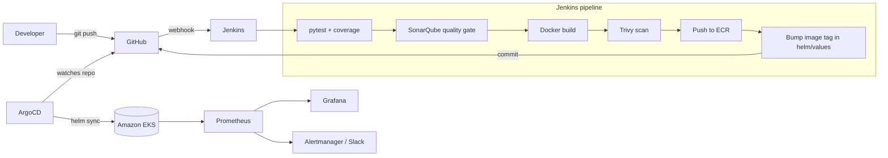

# CI/CD Pipeline for Microservices on AWS EKS

End-to-end CI/CD setup for two Python microservices running on Amazon EKS.
Every push to `main` is tested, scanned, built into a container image, pushed to Amazon ECR and
rolled out to the cluster through GitOps with ArgoCD.


## Architecture



## What is in this repo

| Path | What it does |
|---|---|
| `services/product-service` | FastAPI service that serves the product catalogue |
| `services/order-service` | FastAPI service that checks stock with product-service before creating an order |
| `helm/microservice` | One reusable Helm chart for both services (Deployment, Service, HPA, PDB, Ingress, ServiceMonitor) |
| `helm/values` | Per-service values. Jenkins updates the image tag here on every release |
| `argocd/` | AppProject and Application manifests with automated sync, prune and self-heal |
| `monitoring/` | PrometheusRule alerts and a Grafana dashboard |
| `Jenkinsfile` | Main release pipeline |
| `.github/workflows/ci.yml` | Pull request checks: tests, Helm lint, Hadolint, image build and Trivy scan |

## Pipeline stages (Jenkins)

1. **Unit tests** run in parallel for both services, with coverage and JUnit reports.
2. **SonarQube analysis** and a blocking **quality gate**.
3. **Docker build** using multi-stage images that run as a non-root user.
4. **Trivy scan** fails the build on fixable HIGH or CRITICAL vulnerabilities.
5. **Push to ECR**, tagged with the short git SHA (main branch only).
6. **GitOps update**: `scripts/bump-image-tag.sh` commits the new tag to `helm/values/`.
   ArgoCD sees the commit and performs a rolling update with `maxUnavailable: 0`.
7. Slack notification on success or failure.

## Reliability and security choices

- Rolling updates with readiness probes, so a bad pod never receives traffic.
- HorizontalPodAutoscaler (2 to 6 replicas at 70% CPU) and a PodDisruptionBudget for node drains.
- Containers run as UID 10001 with a read-only root filesystem and all Linux capabilities dropped.
- ArgoCD `selfHeal` reverts manual `kubectl` changes back to what is in git.
- Rollback is a `git revert` of the tag bump commit, or `argocd app rollback order-service`.

## Monitoring

Both services expose Prometheus metrics at `/metrics/`:

- `orders_total{status}`: created, out_of_stock and upstream_error orders
- `product_service_latency_seconds`: latency histogram for service-to-service calls
- `product_lookups_total{result}`

Alerts in `monitoring/alert-rules.yaml` cover upstream errors, p95 latency above 500 ms and crash-looping pods.

## Run it locally

```bash
# Tests
bash scripts/run-tests.sh product-service
bash scripts/run-tests.sh order-service

# Both services with Docker Compose
docker compose up --build
curl localhost:8001/products
curl -X POST localhost:8002/orders -H 'Content-Type: application/json' -d '{"product_id": 1, "quantity": 2}'

# Render the Kubernetes manifests
helm template order-service helm/microservice -f helm/values/order-service.yaml
```

## Deploy to EKS

Prerequisites: an EKS cluster (see my
[terraform-aws-multi-env](https://github.com/sid9743/terraform-aws-multi-env) repo),
ArgoCD, the AWS Load Balancer Controller and kube-prometheus-stack installed.

```bash
kubectl apply -f argocd/project.yaml
kubectl apply -f argocd/product-service.yaml -f argocd/order-service.yaml
argocd app list
```

## Tech stack

Python, FastAPI, pytest, Docker, Jenkins, GitHub Actions, SonarQube, Trivy, Amazon ECR, Amazon EKS,
Helm, ArgoCD, Prometheus, Grafana
